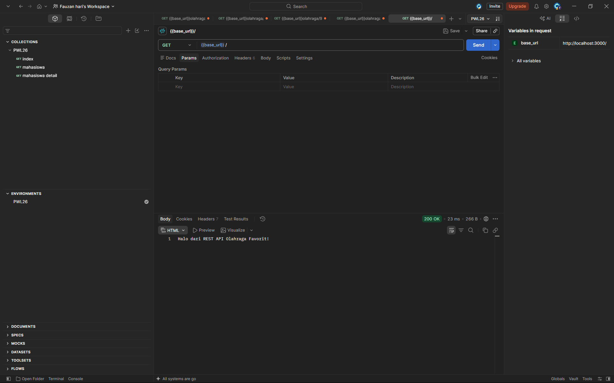
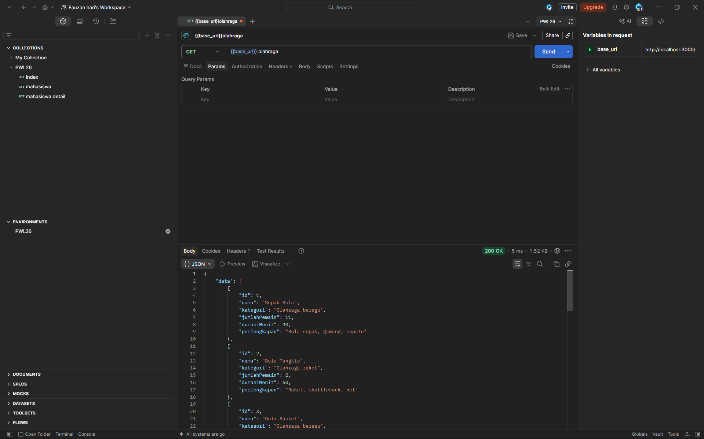
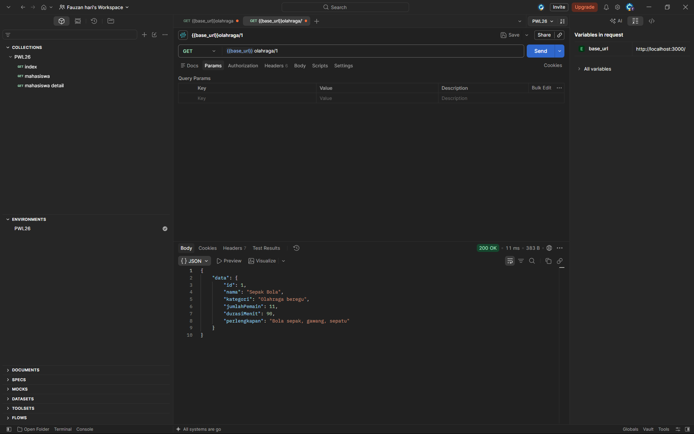
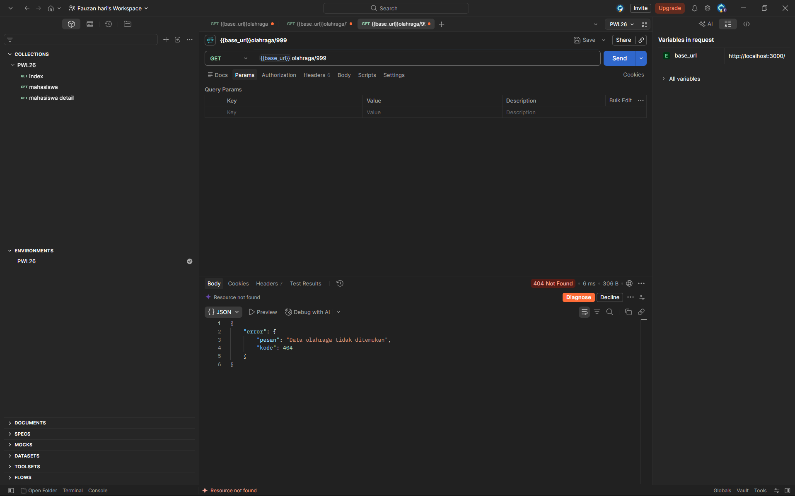
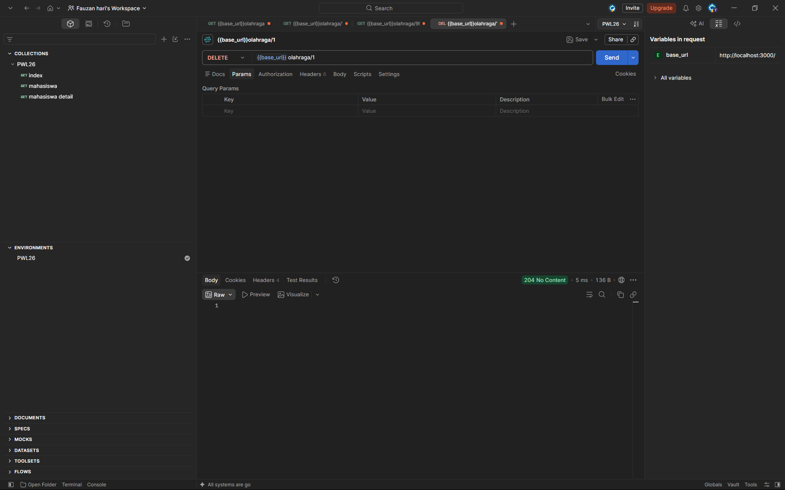
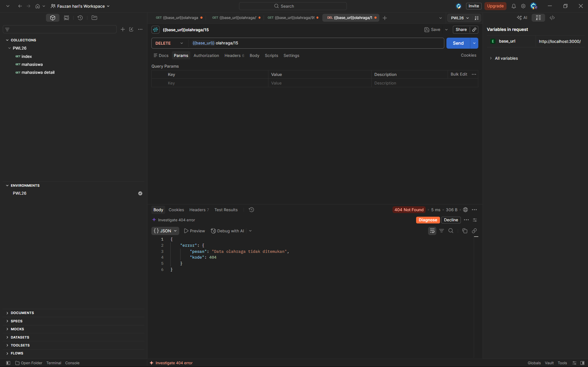

# Tugas 4 - REST API Dasar

## Identitas

- **Nama:** FAUZAN HARI RAMDANI
- **NIM:** F1D02410047

## Deskripsi Tugas

Proyek ini merupakan implementasi REST API dasar menggunakan Node.js dan Express untuk menampilkan data olahraga favorit. Data dibuat dalam bentuk array of objects dan disimpan pada file terpisah di `src/data/olahraga.js`. Setiap objek memiliki `id` unik dan beberapa field lain yang sesuai dengan topik olahraga.

Topik olahraga dipilih karena olahraga memiliki kategori, jumlah pemain, durasi, dan perlengkapan yang bisa direpresentasikan sebagai data terstruktur.

## Cara Menjalankan

1. Pastikan Node.js dan npm sudah terpasang.
2. Buka terminal pada folder proyek.
3. Instal dependensi:
   ```bash
   npm install
   ```
4. Jalankan server:
   ```bash
   npm run dev
   ```
5. Buka `http://localhost:3000`.

Jika port 3000 sedang digunakan, hentikan server lain yang memakai port tersebut atau jalankan di PowerShell dengan:

```powershell
$env:PORT=3001; npm run dev
```

Kemudian akses `http://localhost:3001`.

## Daftar Endpoint

| Method | URL             | Fungsi                                     | Status    |
| ------ | --------------- | ------------------------------------------ | --------- |
| GET    | `/`             | Menampilkan teks sambutan                  | 200       |
| GET    | `/olahraga`     | Menampilkan semua data olahraga            | 200       |
| GET    | `/olahraga/:id` | Menampilkan detail olahraga berdasarkan ID | 200 / 404 |
| DELETE | `/olahraga/:id` | menghapus data berdasarkan ID              | 204 / 404 |

### Contoh respons GET `/olahraga`

```json
{
  "data": [
    {
      "id": 1,
      "nama": "Sepak Bola",
      "kategori": "Olahraga beregu",
      "jumlahPemain": 11,
      "durasiMenit": 90,
      "perlengkapan": "Bola sepak, gawang, sepatu"
    }
  ]
}
```

Respons sebenarnya berisi 10 data olahraga.

### Contoh respons GET `/olahraga/1`

```json
{
  "data": {
    "id": 1,
    "nama": "Sepak Bola",
    "kategori": "Olahraga beregu",
    "jumlahPemain": 11,
    "durasiMenit": 90,
    "perlengkapan": "Bola sepak, gawang, sepatu"
  }
}
```

### Contoh respons ID yang tidak ditemukan

Request: `GET /olahraga/999`

Status: `404 Not Found`

```json
{
  "error": {
    "pesan": "Data olahraga tidak ditemukan",
    "kode": 404
  }
}
```

### Catatan endpoint DELETE

Untuk menguji bonus, kirim request `DELETE /olahraga/1` melalui Postman atau Thunder Client. Jika berhasil, server mengembalikan `204 No Content`. Jika ID tidak ditemukan, server mengembalikan `404`. Data disimpan di memori sehingga akan kembali ke kondisi awal setelah server dimulai ulang, sesuai ketentuan tugas.

## Bentuk Data

Setiap data olahraga memiliki field:

- `id`: angka unik untuk mengidentifikasi data.
- `nama`: nama olahraga.
- `kategori`: kategori olahraga.
- `jumlahPemain`: jumlah pemain dalam format yang umum untuk olahraga tersebut.
- `durasiMenit`: durasi pertandingan/aktivitas dalam menit sebagai contoh data.
- `perlengkapan`: perlengkapan utama yang digunakan.

## Pengujian

1. `GET http://localhost:3000/` → `200 OK`, server berjalan. 
2. `GET http://localhost:3000/olahraga` → `200 OK`, terlihat 10 data. 
3. `GET http://localhost:3000/olahraga/1` → `200 OK`, terlihat detail Sepak Bola. 
4. `GET http://localhost:3000/olahraga/999` → `404 Not Found`. 
5. `DELETE http://localhost:3000/olahraga/1` → `204 No Content`. 
6. `GET http://localhost:3000/olahraga` → jumlah data menjadi 9 
7. `DELETE http://localhost:3000/olahraga/15` → hapus 404 

## Deklarasi Penggunaan AI

| Bagian                        | Alat AI | Digunakan untuk apa                                                                                                               | Bagaimana saya memeriksa hasilnya                                                                                                               |
| ----------------------------- | ------- | --------------------------------------------------------------------------------------------------------------------------------- | ----------------------------------------------------------------------------------------------------------------------------------------------- |
| Data (`src/data/olahraga.js`) | ChatGPT | Membantu menyusun contoh 10 data olahraga beserta struktur objek dan field yang digunakan.                                        | Saya memeriksa jumlah data, keunikan ID, kelengkapan field, dan kesesuaian struktur data.                                                       |
| Route (`index.js`)            | ChatGPT | Membantu membuat dan memperbaiki potongan kode route GET daftar, GET detail, serta DELETE bonus, termasuk penanganan respons 404. | Saya mempelajari alur kode, menjalankan server, dan menguji setiap endpoint melalui Postman untuk memastikan status HTTP dan responsnya sesuai. |
| README                        | ChatGPT | Membantu menyusun kerangka README, menjelaskan endpoint, dan memberikan contoh dokumentasi penggunaan API.                        | Saya menyesuaikan isi README dengan implementasi proyek serta melengkapi dokumentasi berdasarkan hasil pengujian aktual.                        |

**Pernyataan Penggunaan AI**

Saya menggunakan ChatGPT sebagai alat bantu dalam proses pengerjaan tugas REST API Express. AI membantu menghasilkan contoh data, menyusun sebagian kode program, memberikan solusi terhadap permasalahan teknis, dan menyiapkan kerangka dokumentasi. Saya juga mempelajari struktur dan fungsi kode yang dihasilkan, melakukan penyesuaian sesuai kebutuhan tugas, serta memeriksa dan menguji hasil implementasinya secara langsung. Dengan demikian, AI digunakan sebagai pendukung pengerjaan dan pembelajaran, sedangkan saya bertanggung jawab untuk memahami, memverifikasi, dan memastikan hasil akhir sesuai dengan kriteria tugas.

## Kesimpulan & Kendala

### Kesimpulan

Melalui pengerjaan tugas ini, saya mempelajari cara membuat REST API menggunakan Express.js, mulai dari mengatur struktur data, membuat route untuk menampilkan daftar dan detail olahraga, hingga menangani data yang tidak ditemukan. Saya juga memahami penggunaan metode HTTP GET dan DELETE, kode status HTTP, serta format respons JSON. Selain itu, pengujian menggunakan Postman membantu saya memastikan setiap endpoint berjalan sesuai dengan fungsinya.

### Kendala dan Cara Mengatasinya

Selama proses pengerjaan, saya mengalami beberapa kendala, seperti memahami cara mengambil data berdasarkan parameter ID, membedakan respons ketika data ditemukan dan tidak ditemukan, serta memastikan endpoint dapat diakses melalui Postman. Saya mengatasi kendala tersebut dengan mempelajari kembali struktur kode Express.js, memeriksa penulisan URL dan metode HTTP, serta melakukan pengujian secara bertahap. Pada fitur DELETE, saya juga perlu memastikan bahwa penghapusan data yang berhasil menghasilkan status `204 No Content`, sedangkan ID yang tidak ditemukan menghasilkan status `404 Not Found`.
